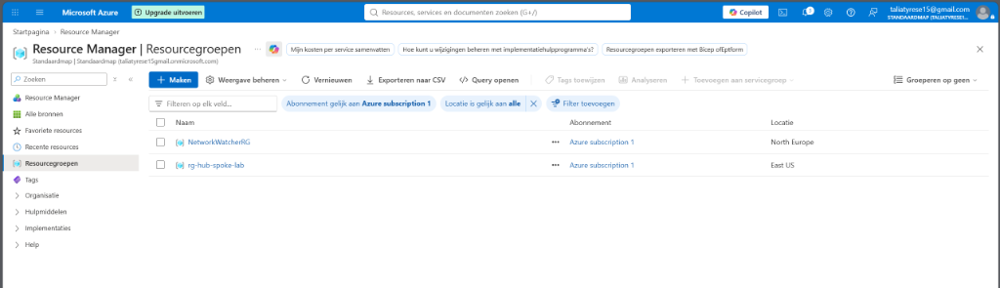
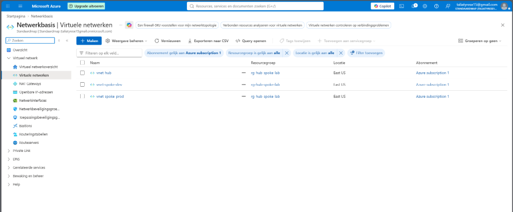
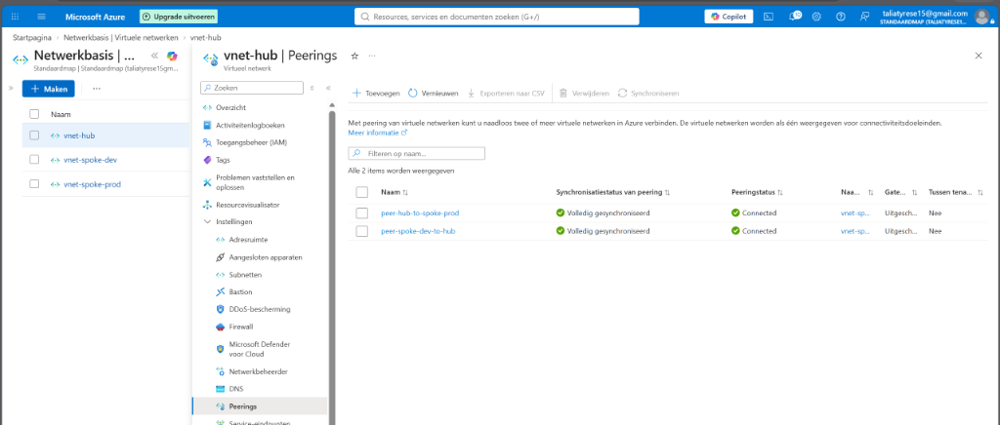
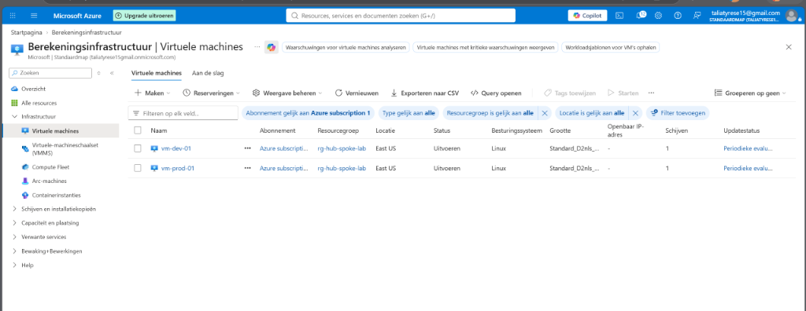
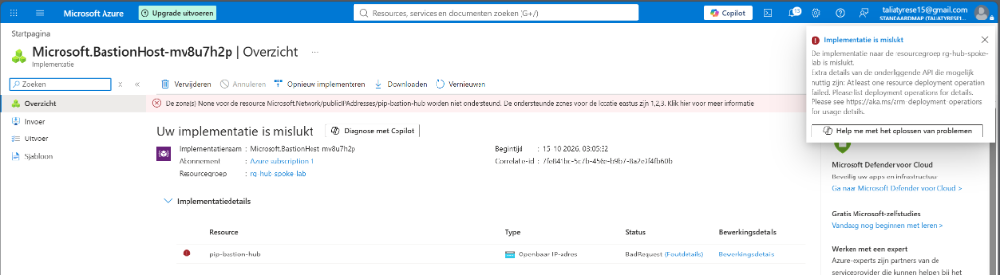
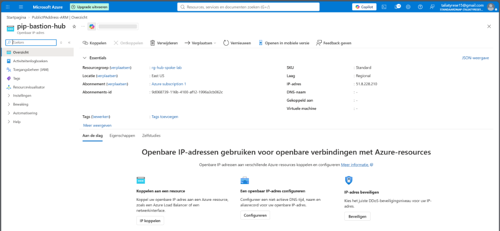
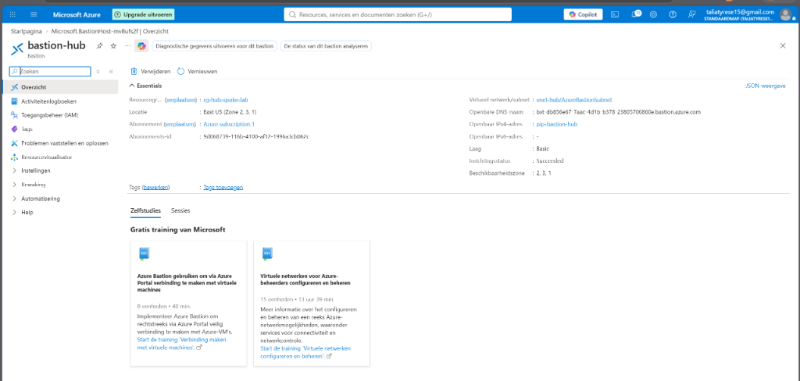
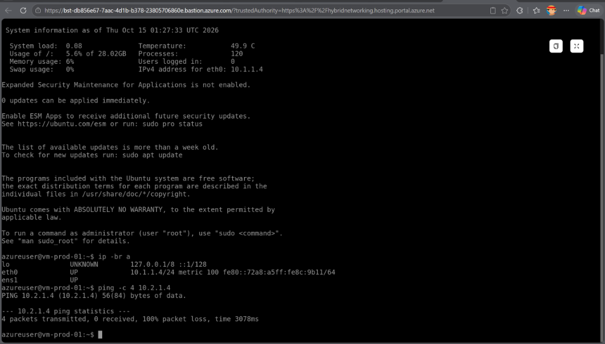
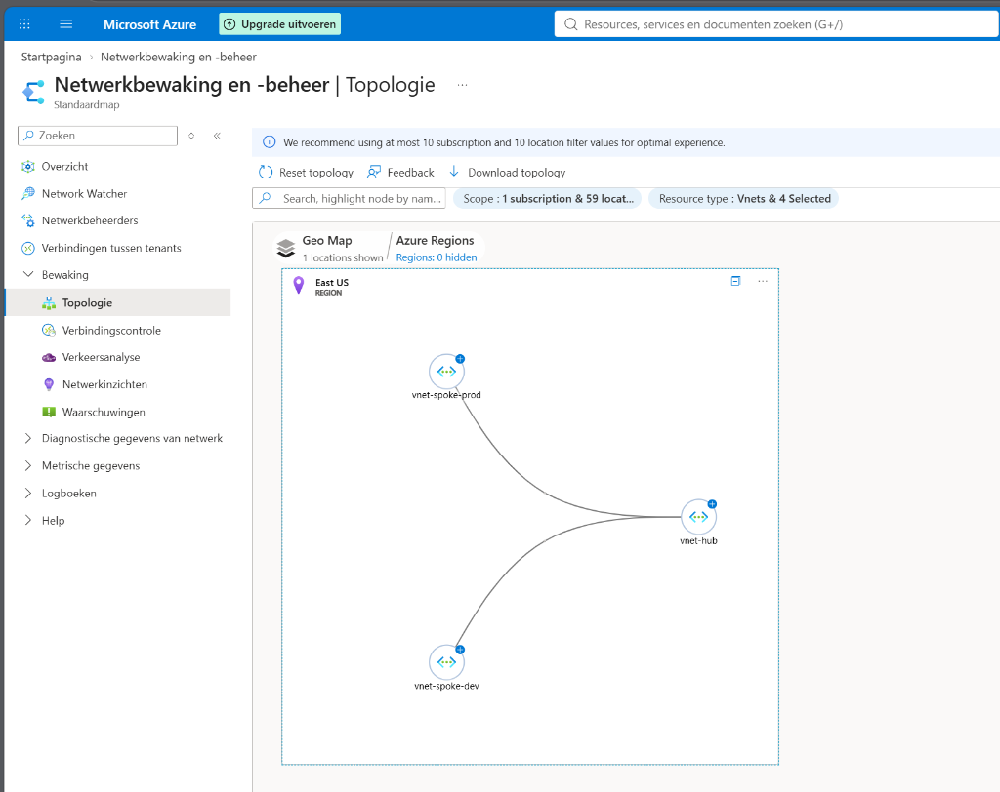

# 📘 Uitgebreide Handleiding: Enterprise Hub-and-Spoke Netwerkarchitectuur

Dit document beschrijft de theorie, achtergrond, ontwerpprincipes en de complete stap-voor-stap implementatie van het Microsoft Azure Hub-and-Spoke lab.

---

## 🧭 1. Wat is dit Lab en Waarom Hub-and-Spoke?

### Het Probleem van een "Flat Network"
In beginnende cloudomgevingen worden resources vaak in één enkel groot virtueel netwerk geplaatst. Naarmate organisaties groeien leidt dit tot ernstige beveiligings- en beheerproblemen:
- Geen scheiding tussen ontwikkel- en productieomgevingen.
- Beheerders moeten openbare beheerpoorten (SSH poort 22, RDP poort 3389) openzetten om bij servers te kunnen, wat leidt tot brute-force aanvallen.
- Geen centrale controle over internettoegang, inspectie en routering.

### De Oplossing: De Hub-and-Spoke Topologie
Het **Hub-and-Spoke model** is de de-facto enterprise standaard aanbevolen door het Microsoft Cloud Adoption Framework (CAF):
1. **Centrale Hub (`vnet-hub`)**: Bevat gedeelde beheerdiensten (zoals Azure Bastion, Firewalls, DNS en ExpressRoute/VPN gateways).
2. **Workload Spokes (`vnet-spoke-prod` & `vnet-spoke-dev`)**: Bevatten uitsluitend applicatieservers. Deze hebben **geen openbaar IP-adres** en geen directe verbinding met het internet.
3. **VNet Peering**: Verbindt elke Spoke afzonderlijk met de Hub met minimale latency en maximale bandbreedte over de Microsoft backbone.
4. **Isolatie**: Omdat VNet Peering **niet-transitief** is, kunnen Spokes onderling niet communiceren, tenzij expliciet gerouteerd via een centrale Firewall/NVA.

---

## 📐 2. Netwerkplan & IP-Adressering

Bij het ontwerpen van een Hub-and-Spoke netwerk is het cruciaal dat CIDR-blokken **nooit overlappen**:

```
+-------------------------------------------------------------+
| vnet-hub: 10.0.0.0/16                                       |
|  ├─ AzureBastionSubnet: 10.0.1.0/26 (Verplicht min. /26)    |
|  └─ snet-hub-mgmt:      10.0.2.0/24                         |
+-------------------------------------------------------------+
             ▲                                ▲
             │ Peering                        │ Peering
             ▼                                ▼
+---------------------------+    +----------------------------+
| vnet-spoke-prod:          |    | vnet-spoke-dev:            |
| 10.1.0.0/16               |    | 10.2.0.0/16                |
|  └─ snet-prod:            |    |  └─ snet-dev:              |
|     10.1.1.0/24           |    |     10.2.1.0/24            |
|     (vm-prod-01: 10.1.1.4)|    |     (vm-dev-01: 10.2.1.4)  |
+---------------------------+    +----------------------------+
```

---

## 🛠️ 3. Stap-voor-Stap Uitvoering in de Azure Portal

### Stap 1: Resource Group Aanmaken
Een Resource Group bundelt de levenscyclus van alle onderdelen.
- **Naam**: `rg-hub-spoke-lab`
- **Regio**: `East US`



---

### Stap 2: Virtuele Netwerken (VNets) Inrichten
Drie VNets zijn aangemaakt met strikt gescheiden adresruimtes:
1. `vnet-hub` (`10.0.0.0/16`): Bevat `AzureBastionSubnet` (`10.0.1.0/26`) en `snet-hub-mgmt` (`10.0.2.0/24`).
2. `vnet-spoke-prod` (`10.1.0.0/16`): Bevat `snet-prod` (`10.1.1.0/24`).
3. `vnet-spoke-dev` (`10.2.0.0/16`): Bevat `snet-dev` (`10.2.1.0/24`).



---

### Stap 3: Bi-directionele VNet Peering Configureren
Om dataverkeer tussen de Hub en de Spokes mogelijk te maken zijn twee bi-directionele peeringkoppelingen opgezet:
- `peer-hub-to-spoke-prod` ↔ `peer-spoke-prod-to-hub`
- `peer-hub-to-spoke-dev` ↔ `peer-spoke-dev-to-hub`

Beide koppelingen stonden binnen enkele seconden op **Volledig gesynchroniseerd** en **Connected**:



---

### Stap 4: Virtual Machines Provisioning (Zero-Exposure)
Twee virtuele machines (Ubuntu Server 24.04 LTS) zijn uitgerold:
- `vm-prod-01` in `vnet-spoke-prod` (Subnet `snet-prod`)
- `vm-dev-01` in `vnet-spoke-dev` (Subnet `snet-dev`)

> ⚠️ **Zero-Exposure Policy**: Bij beide VM's is het openbare IP-adres expliciet ingesteld op **Geen (None)** en zijn binnenkomende poorten op de netwerkkaart gesloten.



---

### Stap 5: Azure Bastion & Zone-Redundantie (Incident & Oplossing)
Bij de initiële uitrol van Azure Bastion werd een `BadRequest` geretourneerd omdat Standard Public IP's in `East US` verplicht aan een Availability Zone gekoppeld moeten zijn:



**De Oplossing**:
Handmatig een Standard Public IP `pip-bastion-hub` aangemaakt met **Zone-redundantie (Zones 1, 2, 3)**:



Hierna is Azure Bastion succesvol geïmplementeerd binnen `vnet-hub/AzureBastionSubnet`:



---

### Stap 6: Zero-Trust Toegang & Spoke-to-Spoke Isolatietest

Via Azure Bastion is direct in de browser via HTTPS verbinding gemaakt met `vm-prod-01`.

```bash
# 1. Bevestig privaat IP van de productie VM
azureuser@vm-prod-01:~$ ip -br a
eth0             UP             10.1.1.4/24

# 2. Test connectiviteit naar development VM
azureuser@vm-prod-01:~$ ping -c 4 10.2.1.4
PING 10.2.1.4 (10.2.1.4) 56(84) bytes of data.
--- 10.2.1.4 ping statistics ---
4 packets transmitted, 0 received, 100% packet loss, time 3078ms
```



### Waarom trad er 100% packet loss op?
Azure VNet Peering is **niet-transitief**:
- Hub kent de routes naar Spoke-Prod en Spoke-Dev.
- Spoke-Prod kent de route naar de Hub, maar **niet** naar Spoke-Dev.
- Hierdoor kan verkeer niet zomaar "hoppen" via de Hub. Dit voorkomt dat een gecompromitteerde development server kan pivoteren naar een productieomgeving!

---

### Stap 7: Azure Network Watcher Topologie Verificatie
Tot slot is de complete netwerktopologie geverifieerd via **Azure Network Watcher**:



Dit levert het onomstotelijke visuele bewijs van de stervormige Hub-and-Spoke architectuur.

---

## 💰 4. FinOps & Levenscyclusbeheer

Azure Bastion rekent een vast uurtarief (~€0,19/uur). Om te voorkomen dat ongebruikte labresources kosten genereren, is de volledige infrastructuur na afronding van de tests opgeruimd:

```bash
az group delete --name rg-hub-spoke-lab --yes --no-wait
```
